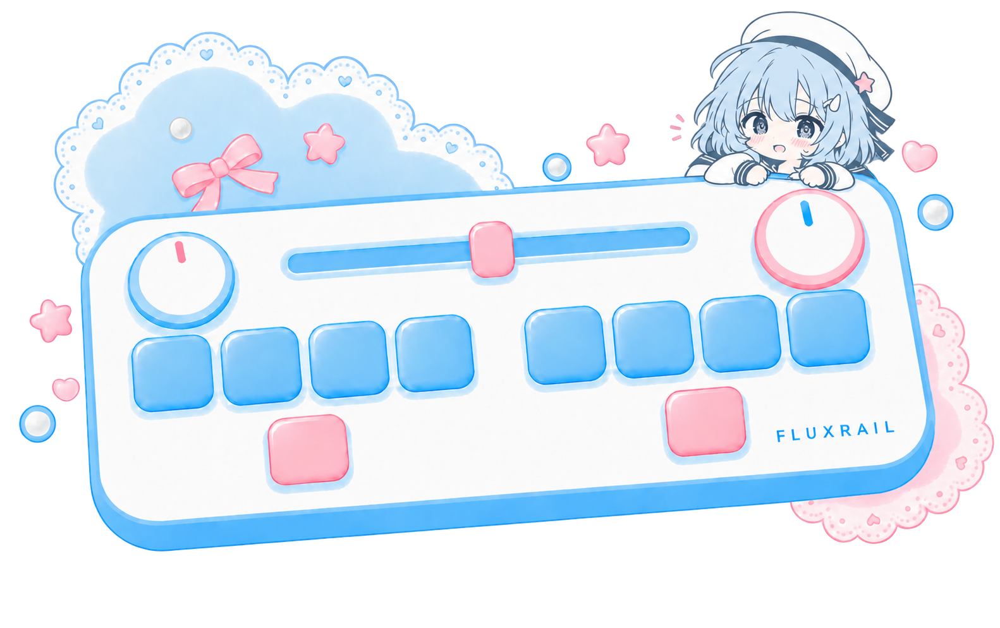

# FluxRail 水色少女 · 基础素材库 v1

保存日期：2026-10-05（北京时间）。用户已确认喜欢图②，并认可主题配色优化，要求作为后续基础素材。角色暂未正式命名。

推荐使用以下主题配色版：

| 半身角色 | 头像 | 音游键盘插画 |
| --- | --- | --- |
|  |  |  |

## 浏览与使用

- [离线图册](index.html)：推荐版、原色/黑白、早期候选、导出图标和风格参考；无需联网，可双击HTML打开。
- [角色与配色规范](STYLE_GUIDE.md)：角色特征、用户偏好、配色、继续生成的基础提示词和版本规则。
- [素材目录](catalog.json)：18个文件的稳定ID、名称、状态、用途、尺寸、透明通道、来源、SHA-256及Web对应路径。
- [SHA清单](manifest.json)：图片、目录说明和提示词的完整文件清单。
- [全部生成提示词](metadata/generation-prompts.json)：原始候选、选定图、头像、控制器合成和主题优化；记录来源输入映射。
- [实际验证](evidence/2026-10-05/README.md)：复制字节一致、文件完整性、离线浏览、文档检查。

`masters/`保存已选定角色及其衍生原图，共6张；`explorations/`保存黑白版和3张早期候选，共4张；`exports/`保存现用的5个PNG与1个多尺寸ICO；`references/`保存黑白漫画风格参考和合成前的原兔子键盘插画。漫画作者与许可未确认，目录明确标记为参考素材。

图册、目录和原图放在项目内，可随项目版本管理。当前Web资源仍在 `web/assets/`，本轮只建立素材库，不改网页功能或设备状态。不同界面使用素材库对应图片导出副本时，保留透明背景、角色内部白色和宽高比。新表情/动作从推荐主题原图出发，沿用角色特征；保留原色、旧版本、旧清单和旧测试证据。

校验：根目录执行 `python design/asset-library/fluxrail-mizuiro/tools/verify_library.py`。它只读校验清单与原图，不生成新图片，不覆盖证据。
